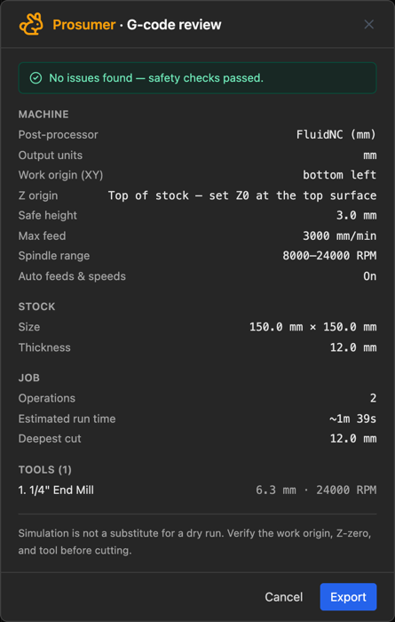

# 10. Simulating and exporting

Everything up to here has been about making toolpaths. This chapter is about the last
stretch: checking they do what you meant, translating them into your controller's dialect,
and getting the file onto the machine.

---

## The simulator

Press **Simulate G-code** in the toolbar — the green button, grey until there is a toolpath
to simulate. The program is built from every visible operation, in program order
(**Paths → Toolpaths**), and loaded into the player. While it's open the button turns into a
red **Stop**, which closes the simulator just as the player's **×** does — useful when
you've hidden the player in the 3D view.

**It opens on the finished part, not on bare stock.** That's deliberate — the question you
opened the simulator to answer is usually *what does this come out like*, and showing you
the answer immediately beats making you watch four minutes of cutting first. Press
**Play** and it winds back to bare stock and animates from there.

**On a job of several sheets it plays one of them** — the one picked in the toolbar's
**◀ Sheet N of M ▶** picker. Step the picker and the simulation rebuilds for that sheet.

| Control | Does |
|---|---|
| **Play / Pause** | Or the spacebar |
| **Reset** | Back to the start |
| **Seek** | Scrub anywhere in the program |
| **1× 5× 20× 100×** | Playback speed |
| **Document icon** | Opens the G-code viewer, which follows along line by line |
| **×** | Closes the simulator |

*The player under the stock: the position and progress bar above the controls, the spindle
and chip load bar below them, and the program's messages above both.*

<!-- FULL APP · 1600 px wide. The chapter 1 shot, reused: npm run shots -- 01-sim-3d. -->

### The readouts

Two bars sit under the stock, and they are the reason to run a simulation rather than just
look at the toolpath.

**Position and progress** — the current **line number**, the tool's **Z**, the **feed**
(or `rapid`), and elapsed against total cycle time. That total is worth reading before you
commit an evening to a job.

**Spindle and chip load** — the RPM with its router dial equivalent, and the chip load as
`actual / target` with a verdict: 🔴 *rubbing · too hot*, 🟢 *sweet spot*, 🔵 *chips too
large*. See [chapter 3](03-stock-and-tools.md#the-chip-load-gauge) for the bands. On manual
feeds it also suggests the feed that would bring you back into the band.

### 2D and 3D

**2D View** plays the program flat, with a trail behind the tool. It's the quicker read
for travel moves, ordering and retracts.

*The same moment in 2D. The trail is coloured by chip load against the aim — the legend
under the player gives the bands — so a stretch cut too light or too heavy shows where it
happened.*

<!-- FULL APP · 1600 px wide. npm run shots -- 10-sim-2d. -->

**3D View** removes real material from a solid block. This is the one that tells you what
the part will look like — scallops, flat spots, an over-deep pocket. The toggles top-right
turn **Axes, Toolpaths, Stock, Tool, Shapes** and **Follow Tool** on and off.

### It keeps itself up to date

Leave the simulator open, change an operation, and **it rebuilds and reloads by itself**
once the operations settle. You don't have to press Simulate again. An imported `.gcode`
file is the exception — that program is not something the app generated, so it is left
alone.

> **What a simulation proves and what it doesn't.** It proves the toolpaths do what you
> meant — the right shapes, the right depths, in the right order. It knows nothing about
> whether your machine is trammed, your stock is where you think it is, your workholding
> will hold, or your bit is sharp. The export review says this too, and it is right to.

---

## The post-processor

Controllers disagree about the details of G-code. A **post-processor profile** is the set
of rules for turning toolpaths into the dialect yours speaks.

<!-- FULL APP · 1600 px wide, downscaled from a 2× capture. -->

Nine profiles are built in — **FluidNC (mm)**, **FluidNC (inches)**, **Grbl (mm)**,
**Grbl (inches)**, **grblHAL**, **LinuxCNC**, **Mach3**, **UCCNC** and a **Generic** one.
FluidNC (mm) is the default; it and the Grbl profiles cover most hobby machines.

The buttons across the top act on the profile selected in the list: **Duplicate** copies
it, **Export** saves it as a `.fkset` file to share, and **Delete** removes it (the last
one can't go). **Add Profile** starts a new one, **Import** brings profiles in from a
`.fkset` — always *added* beside yours, never over them — and **Restore Built-ins** puts
every built-in back to factory and brings back any you deleted, leaving your own alone.

Any of them can be edited, and a built-in carries a **Reset** button that puts it back to
factory defaults, so you can experiment without losing the original. To keep both,
duplicate a profile and edit the copy.

### What's in a profile

| Setting | Emitted |
|---|---|
| **Name** | Into the file header |
| **Unit mode** | Sets the coordinates *and* emits G20/G21 |
| **Comment style** | `; semicolon`, `( parenthesis )` or none |
| **Start G-code** | Once at job start, after G20/G21 |
| **End G-code** | Once at job end |
| **Tool change G-code** | Before each new tool |
| **Spindle on / off** | `{s}` is the speed |
| **Rapid / Cut move** | `{x} {y} {z} {f}` |
| **Arc CW / CCW** | `{i} {j}` centre offsets — and a switch to turn arcs off entirely |
| **Compact G-code** | On by default: each move writes only the G, X, Y, Z and F that changed |

**Unit mode is the only thing that decides whether the file is in inches or millimetres.**
The toolbar's mm/in toggle is a display setting and has no effect on the exported file.

**Keep the placeholders on their own axes** — `X{x} Y{y}`, `I{i} J{j}`. If your machine's
axes run the other way round, set **Setup → Machine Axes** ([Machine
axes](03-stock-and-tools.md#machine-axes)) rather than swapping them here: a swap mirrors
the part and runs every arc backwards, and the move and arc fields say so in amber if a
template does it.

**Compact G-code** leaves out of each move whatever the controller already holds. G0/G1,
the axes and the feed are all *modal* — they stay in force until changed — so after
`G1 X10 Y5 Z-1 F800`, a move to X12 is written as just `X12`. The file comes out much
smaller and the controller runs it exactly the same; the simulator and Resume read it either
way. Every built-in profile is for a controller that works this way. **Turn it off** only
for firmware that needs every word on every line (Marlin, unless it was built with motion
modes).

**Turn off Output arc moves** if your controller's arc handling is unreliable — everything
comes out as short straight moves instead. Bigger file, no arcs to misinterpret.

The **tool change** block is worth setting up properly. The default `M5` / `M0` stops the
spindle and pauses so you can change the bit and re-zero. If your controller handles tool
changes differently, this is where to say so.

### Sharing a profile

The **Import** and **Export** buttons at the top of the profile list (the same icons as
the toolbar's) share a profile with someone else: **Export** saves the selected profile as
a `.fkset` file, and **Import** brings profiles in from one. An imported profile is always *added* — if you already have one with
the same name but different contents, it comes in as *"Name (imported)"* beside yours, and
an identical one is skipped. Nothing you have is changed. A check shows what's about to come in, with **OK** and **Cancel**, before anything does.

**Restore built-ins** (the list icon beside them) resets every built-in profile to factory
and brings back any you deleted. Your own profiles are kept as they are. It lists exactly
which built-ins lose your edits and which come back before anything changes.

---

## The export review

**Export G-code** runs a preflight check first and shows you a **G-code review** before
writing anything.

### The summary

Read the top block against reality, because this is the last point at which a mistake is
free:

- **Post-processor and output units** — is this the file your controller wants?
- **Work origin (XY)** and **Z origin** — do these match how you actually zeroed the
  machine? The Z line spells it out: *"Top of stock — set Z0 at the top surface."*
- **Safe height, max feed, spindle range** — your machine's limits as the app understands
  them.
- **Operations, estimated run time, deepest cut** — is the deepest cut deeper than your
  stock, and is the run time what you expected?
- **Tools** — every cutter the program calls for, with its speed.

### The warnings

Warnings don't block the export; the button just changes to **Export anyway**. Read them
anyway. They cover:

- Operations that **failed**, or that are **stale** because their geometry changed after
  the toolpath was generated
- Toolpath that runs **outside the stock**, or past your machine's **table travel** or
  **Z travel**
- **Tool changes and spindle commands** your controller may not act on
- **Chip load** outside a safe band, and spindles that can't run slow enough for the
  material's surface speed
- For inlays, a **male plug that doesn't match its female socket**

### More than one sheet

When the parts are spread over several sheets of stock (see
[More than one sheet](09-nesting.md#more-than-one-sheet)), the review says so above the
button — *"The parts are on 3 sheets: one file per sheet with toolpaths (3), each cut from
the sheet's own corner"* — and the button becomes *Export 3 sheets*.

Each sheet is its own program, named `<project>_sheet2` and so on, with its toolpaths
moved so that sheet's corner is the work origin. The checks — on the stock, table travel,
deepest cut — judge every operation against its own sheet, not against sheet 1. A sheet
whose parts have no toolpaths yet gets no file.

**Simulate G-code** and the Machine tab work on **one sheet at a time**: the one picked in
the toolbar's **◀ Sheet 1 of 3 ▶** picker.

A **tiled** job works the same way with tiles instead of sheets — *Export 4 tiles*, files
named `<project>_tile2` and so on, each checked at its own origin. See
[14. Double-sided and tiled jobs](14-double-sided-and-tiling.md#tiled-jobs).

### Splitting by tool

If the job uses **more than one tool**, a **Split into one file per tool** option appears,
along with a **File prefix** box. The button becomes *Export N files*.

This is usually the right choice. One file per cutter means you load a bit, run its file,
and stop cleanly — rather than trusting your controller to do something sensible at a tool
change. A single-tool job doesn't offer either option.

---

## Getting it to the machine

The `.gcode` file lands in your downloads. Copy it to your controller however you normally
do.

**On a FluidNC controller you can skip the file altogether:** the **Machine** tab sends
the design straight to the controller's SD card and runs it from there, with a map to
check the job against the stock first. See **[12. Running the machine](12-machine.md)**.

Before you press cycle start, the things the app told you but cannot check:

1. **Zero X, Y and Z where the review said they were.**
2. **Check the first move.** Bring the tool to Z-safe and step through the opening lines
   in your sender before letting it plunge.
3. **Confirm the bit matches** the one the review named.

Then cut it.

---

## Restarting a job that stopped

A broken bit, a power cut, a job you had to cancel half way: the program can be restarted
from where it stopped instead of from the top. A bare "start from line N" in a sender is not
a restart — line N then runs in whatever state the machine happens to be in, while the
program's state at that line was built up by everything before it. FreazyKam writes a new
file that puts that state back first.

1. **Simulate** the job and open the **G-code viewer** (the document icon on the player).
2. **Find the line where it stopped** — scrub the simulator to where the cutting stopped, or
   click the line in the viewer. The simulator shows the stock as it stands at that line.
3. Press **Resume from line N** at the top of the viewer. (It is hidden while playing —
   pause first.)
4. Choose where to restart. Picking one moves the simulator to its line, so you can see
   where it begins; **Cancel** puts it back.

| Restart | Begins | Use it when |
|---|---|---|
| **Carry on from where it stopped** | At that line, coming straight down through the cut already made | The stop was clean and nothing moved |
| **Redo the interrupted pass** | Where the tool last came down from safe height | The pass in progress may be spoilt — a bit broke part way |
| **Recut this part from its start** | The part's first pass, running the ones already cut again through air | You don't trust anything cut on this part |
| **Skip to the next part** | The next part's first pass, leaving this one as it is | Recut the damaged part later with a program of its own |

The panel shows the tool in force, where the tool comes in and how — **up to safe Z, across,
then down at the plunge feed** — and any warnings. Tick **Pause after the spindle command**
when your router is switched by hand: the file stops (M0) once the spindle should be running,
so you can check it before anything moves. Then **Download resume file** and run it like any
other.

**Zero must be exactly where it was for the original run.** If the machine lost power,
alarmed, or the stock moved, find X, Y and Z again first — the resume file goes back to the
coordinates the job was using, and has no way to know they have moved.

The file is the original program's own text from the restart line on, with only the entry
move added, so it works for any controller and for G-code from any CAM program, not only
FreazyKam's. A few states cannot be resumed from a line of G-code alone, and the panel says
so rather than guessing: relative or inverse-time moves, cutter compensation, inside a canned
cycle, after the coordinate system was changed (G92/G10), rotary axes, or before the program
has set X, Y and Z.

---

## Next

- **[11. When something goes wrong](11-troubleshooting.md)** — failures, refusals, and what they mean
- **[12. Running the machine](12-machine.md)** — driving a FluidNC controller from FreazyKam
