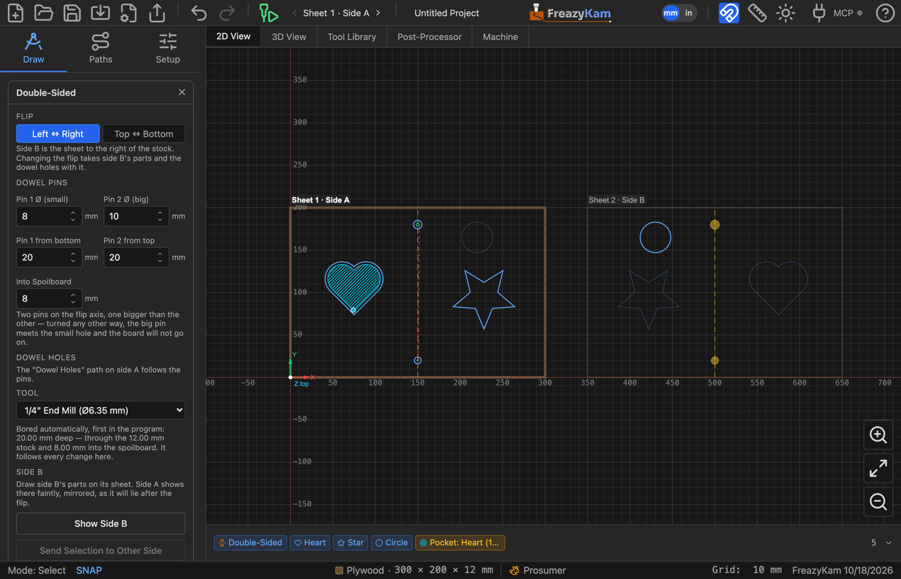
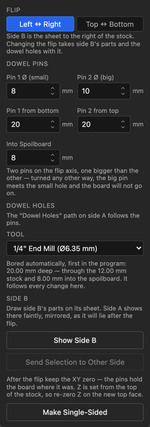
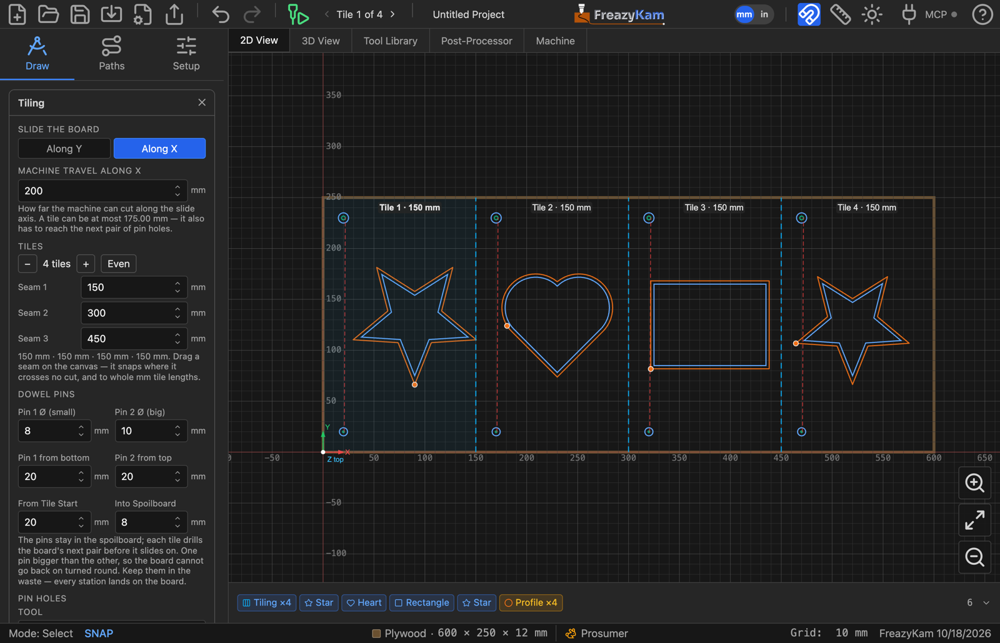
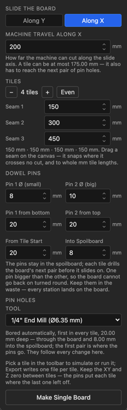

# 14. Double-sided and tiled jobs

Two ways to cut more than one face, or more than one machine's worth, from a single board.
Both lean on the same trick: **dowel pins** in the spoilboard, and holes in the board that
drop onto them, so the board goes back exactly where the program expects it.

- **Double-sided** — cut side A, turn the board over onto the pins, cut side B.
- **Tiled** — a board longer than the machine. Cut it in tiles, sliding it along onto the
  pins between them.

Both are in the machine panel under **CAM Operations**: **Double-Sided** and **Tiling**.
A job is one or the other, and neither works alongside nesting onto more sheets — each is
one board.

---

## Double-sided jobs

*Side A on the stock, side B on the sheet to its right. Side A's parts show faintly on side
B, mirrored as they will lie after the flip; the dashed line is the flip axis and the two
circles on it are the pins.*

<!-- FULL APP · 1600 px wide, downscaled from a 2× capture. -->

### Starting one

Open **Double-Sided** and pick the flip under **Pick the Flip to Start**:

| Flip | Turn the board over… | Side B is drawn |
|---|---|---|
| **Left ↔ Right** | about its vertical centre line | on a sheet to the right of the stock |
| **Top ↔ Bottom** | about its horizontal centre line | on a sheet below the stock |

That is all there is to it: the side B sheet appears, the dowel holes are placed on the
flip axis, and their drilling is added to the program. The job needs the stock to be its
only sheet; if parts are on other sheets, move them onto the stock first.

### Drawing side B

**Side B's sheet shows the board as you will see it after the flip.** Draw side B's parts
there as you want them cut — the coordinates on that sheet are the machine's coordinates
after the flip, so its toolpaths are generated like any other and cut exactly as drawn.
They are never made by mirroring side A's toolpaths: a mirrored toolpath turns a climb cut
into a conventional one.

What helps you line the two faces up:

- **The guide.** Each side's parts are drawn faintly on the other, mirrored as the flip
  puts them.
- **Snapping.** A part dragged on one side snaps to the edges and centres of the other
  side's parts, as the guide draws them, as well as to its own sheet's edges.
- **Send to Other Side** in the form mirrors the selected paths across the flip axis onto
  the other sheet — for a feature cut from both faces, such as a chamfer on both edges of
  a hole. Sent over and back, a path comes back exactly where it was.

**Changing the flip later** takes side B's parts with it to the new sheet, turned to suit,
and moves the dowel holes onto the new axis — one step, and one undo.

### The dowel pins

<!-- CROP · native 2×. -->

**Two pins on the flip axis, one bigger than the other.** A point on the axis stays put
when the board turns over about it, so the holes are still over the pins after the flip.
Every *wrong* way to put the board back — the other flip, or a half turn face up — swaps
the two holes end for end, so the big pin meets the small hole and the board won't go on.
Pins of the same size would let it go on wrong, slid along the axis; the form refuses
sizes less than 1 mm apart.

| Setting | What it does |
|---|---|
| **Pin 1 Ø (small)**, **Pin 2 Ø (big)** | The two dowels. 8 mm and 10 mm by default, so a ¼" end mill can bore both |
| **Pin 1 from bottom / left**, **Pin 2 from top / right** | Where each pin sits along the axis, from its own end. Keep them in the waste |
| **Into Spoilboard** | How far the holes go past the stock, for the pins to sit in |

The holes are a path of two circles, **Dowel Holes**, kept on the pins whatever you
change. They are **bored helically** with an end mill — a peck would make both holes the
size of the bit and the pins the same size again. The form picks the largest end mill
that fits the small hole; choose another under **Tool**. The drilling is always the
**first cut** on side A, so the board is pinned before anything is cut loose.

### Running it

1. Run side A. The dowel holes are drilled first, through the stock and into the
   spoilboard.
2. Put the pins in, turn the board over the way you chose, and drop it onto them.
3. Pick **Sheet 2 · Side B** in the toolbar's sheet picker and run side B.

**Keep the XY zero** between the sides — the pins hold the board to the machine, not to its
edges, which are rarely square. **Z** depends on your Stock setting: set from the top of
the stock, re-zero Z on the new top face; set from the spoilboard, leave it.

### Simulating it

The 3D view shows both faces. Simulating **side B**, side A's cuts are there underneath,
and where the two meet you see the hole. Simulating **side A**, the finished part opens
with side B cut too; run or scrub it from the start and side B goes back to bare board,
since side B is cut after side A.

### Ending it

**Make Single-Sided** in the form, or the **×** on the **Double-Sided** chip at the start
of the Objects strip, ends the job. The dowel holes and their drilling go; side B's parts
stay where they are, as an ordinary second sheet.

---

## Tiled jobs

*A board twice as long as the machine's travel, in four tiles. The picked tile is shaded;
each tile starts with its pair of pin holes, one small and one big.*

<!-- FULL APP · 1600 px wide, downscaled from a 2× capture. -->

### Starting one

**Set the stock to the board's real size first**, and design and generate as if your
machine were that big. Then open **Tiling** and pick **Along X** or **Along Y** under
**Pick the Slide Axis to Start** — the way the board will slide between tiles.

The board is split into the fewest equal tiles your machine can reach. **Machine Travel**
starts at the Table Width or Height you set in Machine Limits; change it in the form. A
tile can be a little shorter than the travel: every tile but the last also has to reach
the *next* pair of pin holes.

Nothing about the drawing or the toolpaths changes. A tile is only a window of the
finished program.

### Placing the seams

The seams are the dashed lines across the board. Each tile is labelled with its number
and length.

- **Drag a seam** to move it. It **snaps** to whole millimetres (whole inches in inch
  mode) of tile length, and — where the cursor is over a stretch the toolpaths cut — out
  to the nearest clean break, where it crosses no cut and leaves no seam mark. While
  dragging, the label says **clean break** or, in red, **cuts through a toolpath**. Hold
  **Alt** to drag without snapping.
- A seam can go into any gap, however short that makes the tile before it. If that leaves
  the tile after it too long for the machine, the form says so: add a seam.
- **−** and **+** take a tile away or add one, re-spacing evenly. **Even** re-spaces the
  tiles you have. Each seam's position can also be typed in.

### The pins

<!-- CROP · native 2×. -->

Two pins sit in the spoilboard, a fixed distance into the machine's travel. **Each tile
drills the board's next pair of holes before the board slides on**, and the board slides
until those holes drop onto the pins, so the next tile lines up with the last. The first
tile also drills the first pair right through into the spoilboard — those holes are where
the pins go.

| Setting | What it does |
|---|---|
| **Pin 1 Ø (small)**, **Pin 2 Ø (big)** | Different sizes, so the board can't go back on turned round |
| **Pin 1 from left / bottom**, **Pin 2 from right / top** | Where the pins sit across the board |
| **From Tile Start** | How far into each tile the pins are |
| **Into Spoilboard** | How far the first pair of holes goes past the board, for the pins to sit in |

The pin holes are **Tile Pins** paths, one pair per tile, kept in step with the seams.
They are drilled automatically, helically, and **first in every tile** — choose the end
mill under **Tool**. **Only the first pair goes into the spoilboard**, where the pins live;
every later pair goes just through the board (0.5 mm past it), so the spoilboard isn't left
full of holes that hold nothing. Every station lands on the board, so keep the pins in the
waste.

### Running it

Pick a tile with the toolbar's **◀ Tile 1 of 4 ▶** picker; Simulate and the Machine tab
follow it. **Export G-code** writes one file per tile: `job_tile1`, `job_tile2`, and so on.

1. Run tile 1. It drills the first pair of holes into the spoilboard, and the second pair.
2. Put the pins in the first holes.
3. Lift the board, slide it along the slide axis until the next holes drop onto the pins,
   and run the next tile. Repeat.

**Keep the XY and Z zero** for every tile. Each tile's program is moved so its window starts
at the same machine spot; the pins put the board there.

Where a cut crosses a seam, the tile lifts to safe height, moves over and plunges back in
— no more than one step-down, since the passes above it were cut first in the same tile.

### Ending it

**Make Single Board** in the form, or the **×** on the **Tiling** chip, ends the job: the
pin holes and their drilling go, and the board is one program again.

---

## The G-code review

**Export G-code** checks a double-sided or tiled job too:

- **No dowel holes / pin holes drilled** — no end mill fits the small hole. Pick one in the
  form, or make the pins bigger.
- **The dowel holes go deeper than allowed** into the spoilboard.
- **A tile too long** for the machine.
- A note with the steps: when to put the pins in, which way to turn or slide the board,
  and what to do about zero.

A tiled job is checked tile by tile, each at its own origin, as it will be cut.

---

## Next

- **[10. Simulating and exporting](10-export.md)** — the review before you cut
- **[12. Running the machine](12-machine.md)** — sending each side or tile to the machine
