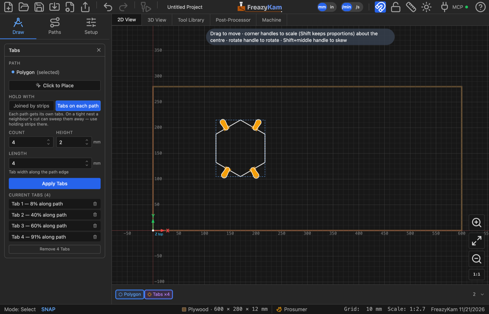

# Add holding tabs

Tabs are small bridges of wood that keep a part from flying loose on the last pass.

1. Select the outline you'll cut out.
2. Under **Path Tools**, click **Tabs**.
3. Set:

   | Field | Typical |
   |---|---|
   | Count | `4` |
   | Length | `8` mm |
   | Height | `2`–`3` mm |

4. Click **Apply Tabs**.
5. Drag any tab along the line to move it.

Any **Profile** on this outline now leaves the tabs.

## Place them by hand

1. Click **Click to Place** in the Tabs form.
2. Click on an outline to put a tab there.
3. Drag a tab to move it. **Shift-click** one to delete it.

## Remove them

Click the bin beside a tab under **Current Tabs** to remove that one, or **Remove N Tabs**
for all of them.

## Several parts at once

Select them all (drag a box), then **Apply Tabs to N Paths**. Every part gets the same
tabs. It's one undo and one chip — click the chip to change them, delete it to remove them.

**Packed tight on a sheet?** Use [holding strips](hold-a-nested-sheet.md) instead. Tabs
can't hold a part to waste that's been cut loose.

## Where to put them

- On straight edges, not corners.
- Away from delicate details.
- Where cleanup is easy. You'll cut them with a chisel and sand.

**Moved parts by nesting?** Check tabs aren't now facing a neighbour.

**Related:** [Cut out a part](cut-out-a-part.md) · [Hold a nested sheet](hold-a-nested-sheet.md)
