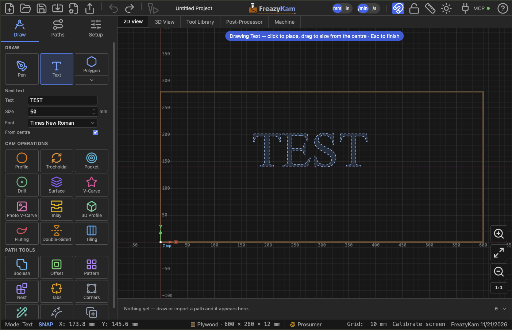

# Add text

Put lettering on your design for engraving, V-carving or cutting out.

1. In the **Draw** tab, click **Text**.
2. Type your words in **Text**, set the **Size** and pick a **Font**.
3. **Click** the canvas to place it at that size, or **drag** to set the size by the
   height of the drag.

The tool stays on, so you can keep clicking to place more. Press **Esc** to put it down.
Tick **From centre** to place and size the text about its middle.

## Pick the right font

| You want to | Use |
|---|---|
| **V-carve** or pocket letters, or cut them out | Any outline font, such as Roboto or Times New Roman |
| **Engrave** with a single line per stroke | **Relief SingleLine (single-line)**. Each letter is open strokes, so cut it with a Profile on the **Centerline** cut side |

The font list previews each font in your own words.

## Change it later

Click the text. Its **T** (text), **Sz** (size) and **Fnt** (font) fields are in the
**Properties** panel. Change them any time and the letters are redrawn.

**Next:** [V-carve lettering](v-carve-lettering.md) · [Lay text along a path](lay-text-along-a-path.md)
