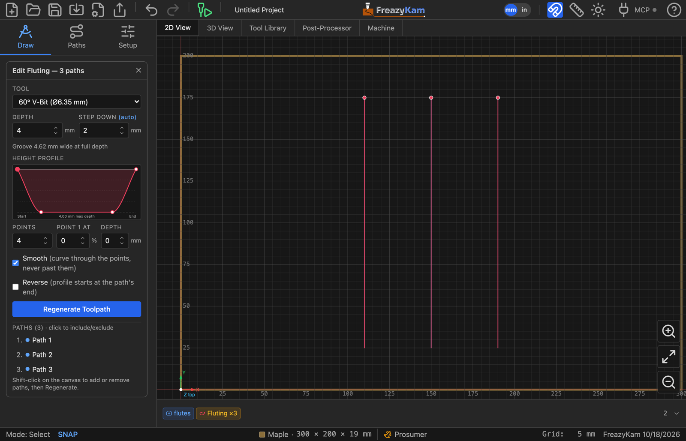
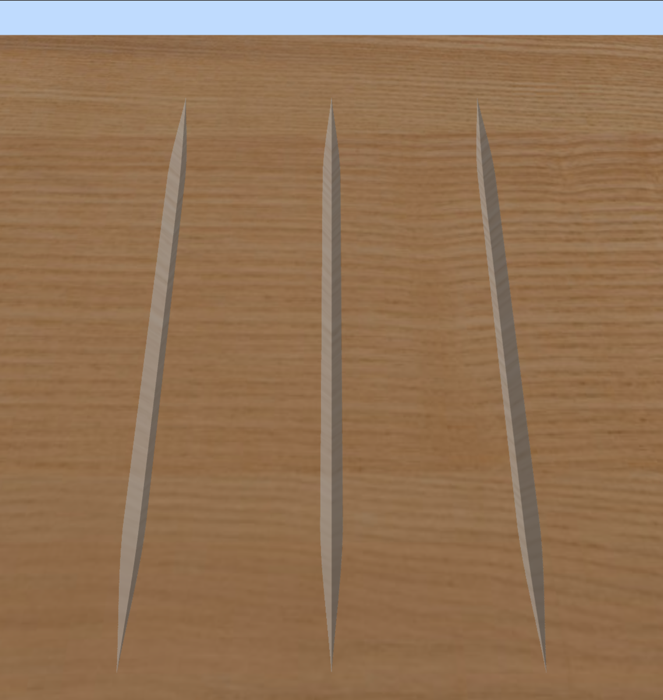

# Carve flutes

Flutes are grooves whose depth changes along their length — down a column or a table leg,
deepest in the middle and fading out at the ends.

1. Draw or import the lines the flutes run along. Open strokes are usual.
2. Select them all.
3. Click **CAM Operations → Fluting**.
4. Pick a **V-bit** (V-groove) or a **ball nose** (round-bottomed flute).
5. Set **Depth** — the deepest point of the flute. The line under it says how wide the
   groove will be there.
6. Shape the **Height Profile**:
   - **Drag the points.** Left is the path's start, right its end. Top is the surface,
     bottom is full depth.
   - Set **Points** for more or fewer breakpoints. The shape is kept.
   - Click a point to type its exact position and depth.
7. Leave **Smooth** on for a curved flute, or turn it off for straight lines between points.
8. Click **Generate Toolpath**.

## The profile runs the wrong way

Tick **Reverse**. The profile then starts at the other end of each path. It only matters
when the profile is not the same at both ends.

## Different lengths

One profile fits them all: it is stretched over each path's own length.

**Related:** [Fluting settings](../reference/operations.md#fluting) ·
[Fluting in the user guide](../../docs/06-vcarve-inlay.md#fluting)
