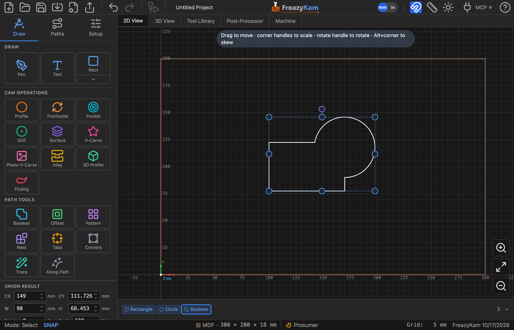

# Combine shapes (Boolean)

Merge shapes, keep only where they overlap, or cut one out of another. **Boolean** is under
**Path Tools** in the Draw tab.

1. Click the shape to **keep** first, then Shift-click the others.
2. Click **Boolean**.
3. Under **Operation**, pick **union**, **intersect** or **subtract**.
4. Click **Apply Boolean**.

For Subtract, the first shape you clicked is kept and the others are cut away from it.
The originals are hidden, not deleted.

## Change it later

Click the result's chip in the Objects strip to change the settings later. You can switch union to subtract, say, without picking the shapes again.

**Related:** [Grow or shrink a shape](offset-a-shape.md) · [Round, chamfer or dogbone corners](round-corners.md)
