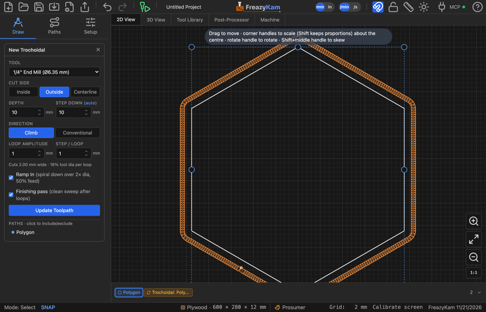
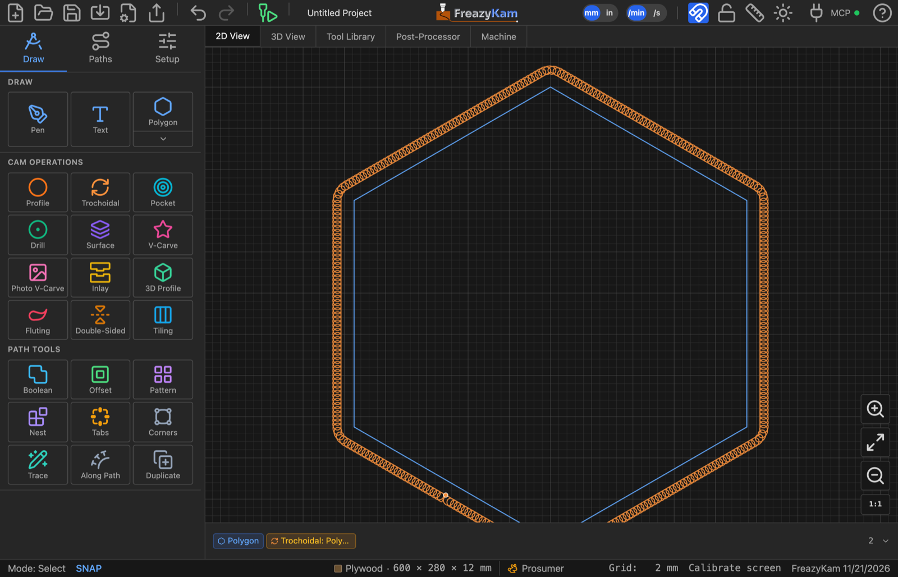

# Cut with loops (Trochoidal)

**Trochoidal** cuts in small overlapping loops instead of ploughing straight along the
line. The bit only ever bites a little, so it's easier on the bit and the machine. Use it
in hard material, on a light machine, or for a deep cut that would be too much in one go.

1. Select the outline, or a line for a slot.
2. Under **CAM Operations**, click **Trochoidal**.
3. Pick the **Tool**.
4. Set **Cut Side**: **Outside** for a part, **Inside** for a hole, **Centerline** for a
   slot (see [Cut a slot](cut-a-slot.md)).
5. Set **Depth**.
6. Set **Loop Amplitude** (how far the loops swing) and **Step / Loop** (how far each loop
   moves on). The line under them says how wide the loops cut and how far each one moves,
   as a share of the tool's width.
7. Tick **Finishing pass** for a clean wall.
8. Click **Generate Toolpath**.

The loops show on the canvas as a band round the line:

**Related:** [Cut out a part](cut-out-a-part.md) · [All Trochoidal settings](../reference/operations.md#trochoidal)
