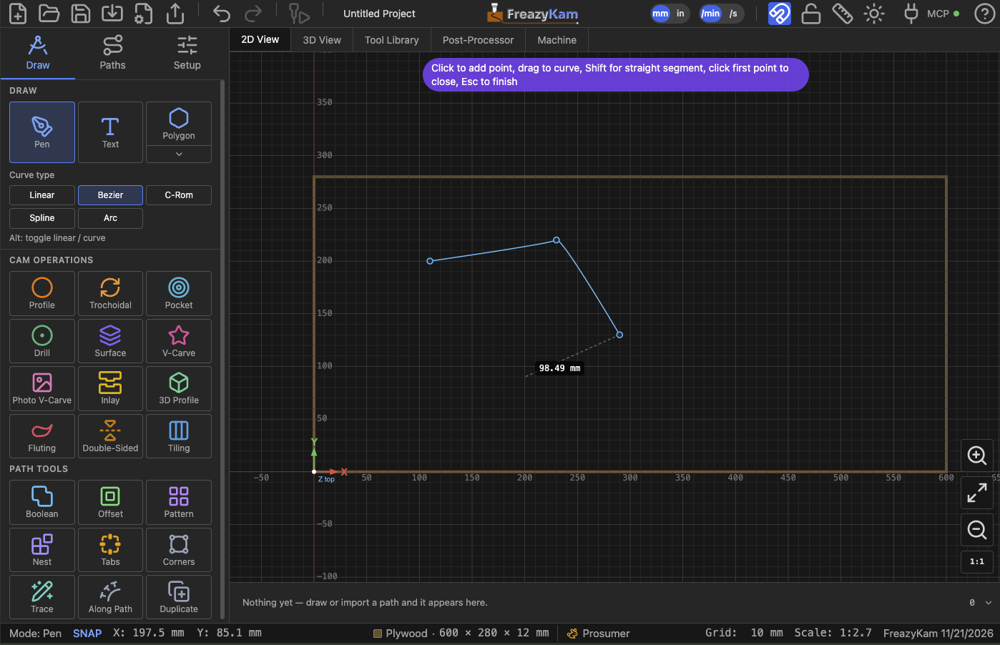

# Draw with the pen

1. In the **Draw** tab, click **Pen**.
2. Pick a curve mode (start with **C-Rom**).
3. Click to place points.
4. To finish:
   - **Closed:** click the first point.
   - **Open:** press **Esc**.

| Key | Does |
|---|---|
| **Shift**-click | Makes the segment to this point straight |
| **Ctrl+Z** | Removes the last point |
| Drag (Bezier mode) | Pulls out curve handles |

## Curve modes

| Mode | Gives |
|---|---|
| Linear | Straight lines |
| Bezier | Curves you shape with handles |
| C-Rom | Smooth curve through every point |
| Spline | Smoother curve through every point |
| Arc | Circular arcs |

**Related:** [Edit points on a path](edit-points.md)
