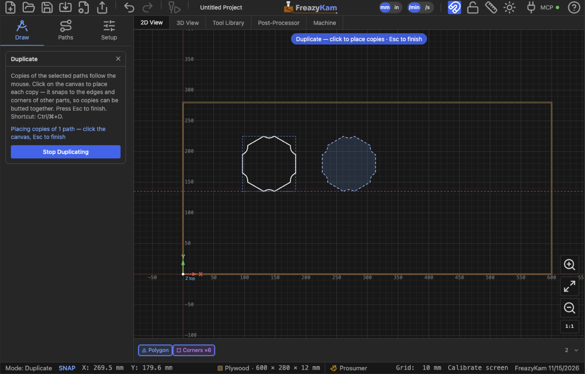

# Place copies with the mouse (Duplicate)

Stamp copies of a selection wherever you click. **Duplicate** is under **Path Tools** in
the Draw tab, or press **Ctrl+D**.

1. Select one or more shapes.
2. Click **Duplicate**, or press **Ctrl+D**.
3. Move the mouse: a copy follows it, snapping to corners and edges of other shapes.
4. Click to place a copy. Keep clicking to place more.
5. Press **Esc** to finish.

A copy stays the shape it came from, so a gear or a boolean can still be edited, and it
keeps the original's name. Each click is one undo step.

## Copies follow the original

Change the original's size or settings and every copy changes to match, each staying where
you placed it. Moving or rotating the original doesn't move the copies.

To make a copy independent, select it and click **Unlink** next to **Linked to …** at the top
of its Properties. Changing the copy's own size or settings unlinks it too.

**Related:** [Repeat a shape](repeat-a-shape.md) · [Copy parts between projects](copy-between-projects.md)
