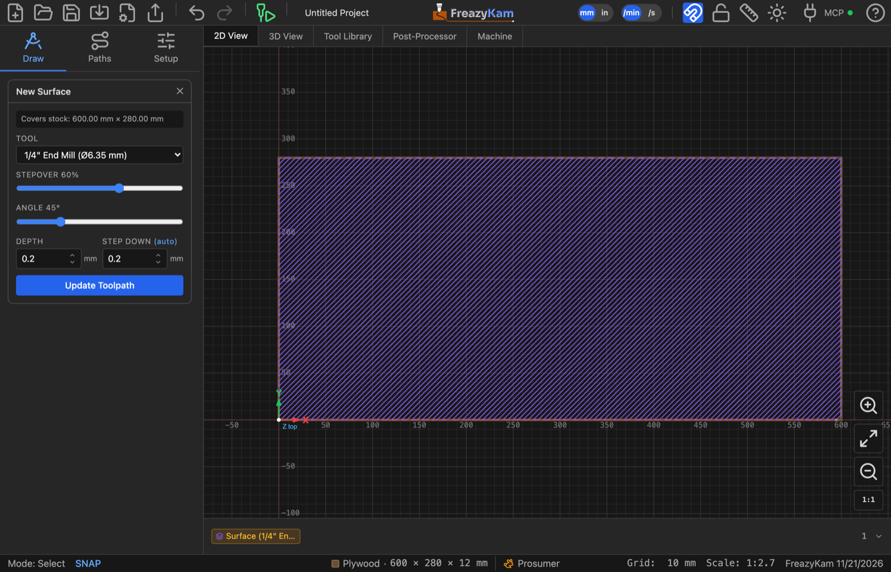

# Flatten your stock

Use **Surface** to face the top of a slab.

1. Under **CAM Operations**, click **Surface**. No selection needed.
2. Pick your biggest **end mill** (Surface only offers end mills).
3. Set **Stepover** and **Angle**.
4. Set a shallow **Depth**.
5. Click **Generate Toolpath**.

The form shows the area it covers: the whole stock. The result is only as flat as your
machine is trammed.

**Related:** [Set your work origin](set-your-work-origin.md) (bottom-of-stock Z suits slabs)
