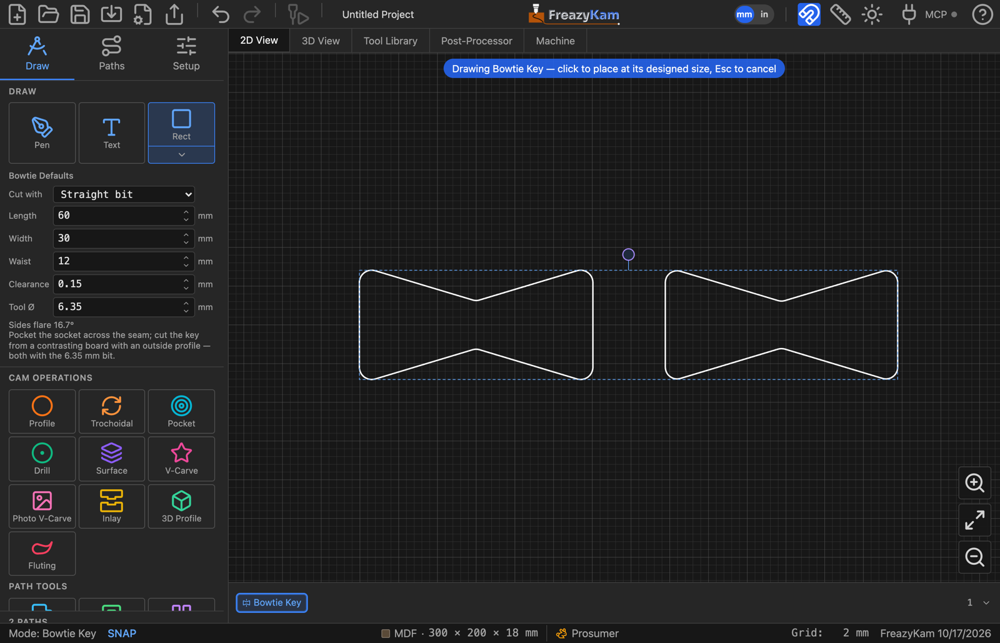

# Inlay a bowtie key

A butterfly key across a seam or a crack.

1. Open the shape picker and click **Bowtie**.
2. Set **Length** (across the seam), **Width** (the ends) and **Waist** (the middle).
3. Choose **Cut with**:

   | Choice | Then |
   |---|---|
   | **Straight bit** | Set **Clearance** and **Tool Ø**. You get a **Socket** and a **Key** |
   | **V-bit (Inlay)** | You get one outline. Select it and use **Inlay** |

4. Click to place it, then move it so the waist sits over the seam.

## With a straight bit

1. **Pocket** the **Socket** into the work, to the depth you want the key.
2. Cut the **Key** from a contrasting board with an **outside Profile**.

Both are rounded for the bit, and the key is the clearance smaller all round, so it drops
in.

**Related:** [Bowtie settings](../reference/shapes.md#bowtie) ·
[Make an inlay](make-an-inlay.md)
