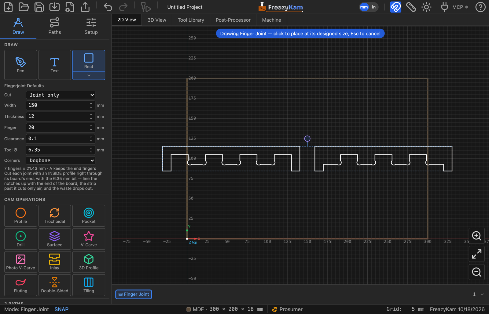
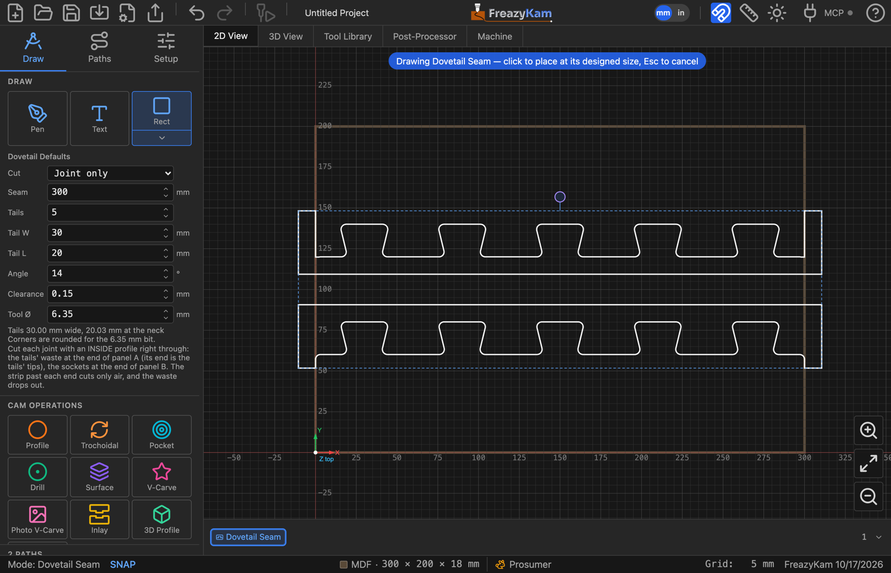

# Join two boards with a finger joint or dovetail

For boards you already have — a drawer side and front, or two halves of a top too big for
the machine.

1. Open the shape picker and click **Finger** (a corner joint) or **Dovetail** (two panels
   edge to edge, in the face of the sheet).
2. Leave **Cut** on **Joint only**.
3. Set the joint:
   - **Finger:** **Width** = the boards' width.
   - **Dovetail:** **Seam** = the length of the joint, then **Tails**, **Tail W**,
     **Tail L** and **Angle**.
4. Set **Thickness**, **Clearance** and **Tool Ø** (the bit you'll cut with).
5. Click to place it. You get two U-shaped outlines — the **waste** at each board's end.
6. Move each one onto its board: the board's end along the inside of the U's bar, its sides
   along the insides of the legs.
7. **Profile** each with **Cut Side: Inside**, right through the board.

The bit runs in air along the bar and the legs, and cuts the joint between the fingers or
tails. The waste drops out on the last pass.

## Dovetail: which shape goes where

| Shape | Goes on | Note |
|---|---|---|
| **Sockets** (upper) | Panel B | Its end is the seam |
| **Tails** (lower) | Panel A | Its end is the tails' tips — leave it **Tail L** longer |

## Cutting both boards out of a sheet instead

Set **Cut** to **Whole boards**, enter each board's length, and profile them **outside**.

**Related:** [Finger](../reference/shapes.md#finger) ·
[Dovetail](../reference/shapes.md#dovetail) settings ·
[Joinery in the user guide](../../docs/08-parts.md#cutting-a-joint-into-the-end-of-a-board)
