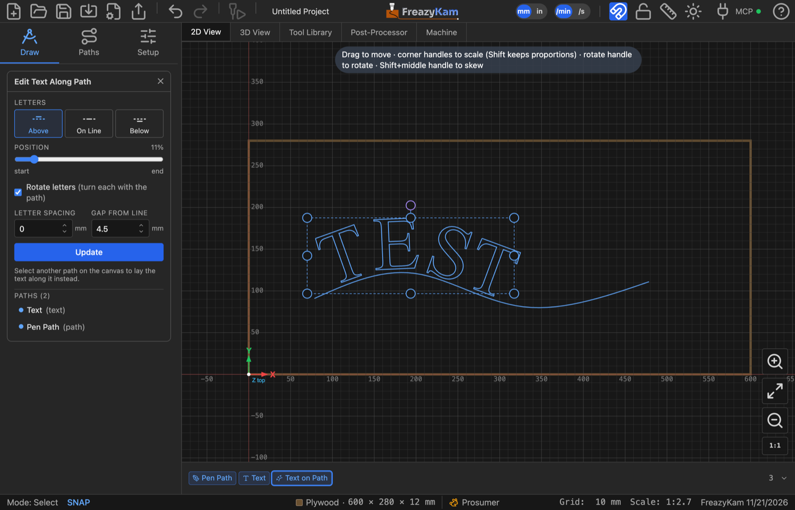

# Lay text along a path (Along Path)

Run a line of text round a circle or along a curve. **Along Path** is under **Path Tools**
in the Draw tab.

1. Add your text with [**Text**](add-text.md) in the Draw tab, and draw the path to follow.
2. Select the text, then Shift-click the path.
3. Click **Along Path**.
4. Under **Letters**, pick where they stand: **Outside**, **On Line** or **Inside** for a
   closed path, **Above**, **On Line** or **Below** for an open one.
5. Drag **Position** to move the text along the path.
6. Click **Apply**.

The text always reads left to right and upright. The result shows on the canvas while
the form is open.

## Fine-tune it

| Field | Does |
|---|---|
| **Rotate letters** | Turns each letter with the path. Untick to keep every letter upright |
| **Letter Spacing** | Extra space between letters |
| **Gap From Line** | How far the letters stand off the path |

The original text is hidden, not deleted. Click the result's chip in the Objects strip to
change the settings later. Select a different path while the form is open to move the text
onto it.

**Related:** [V-carve lettering](v-carve-lettering.md) · [Shapes and text](../reference/shapes.md#outlines-and-text)
