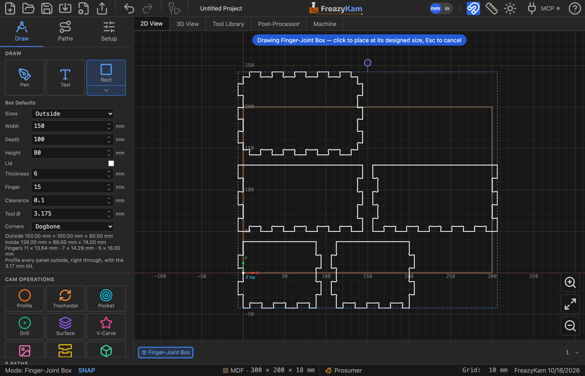

# Make a finger-jointed box

1. Measure your board's thickness with calipers.
2. Open the shape picker and click **Box**.
3. Set:

   | Field | Enter |
   |---|---|
   | **Sizes** | **Outside** or **Inside** — which the sizes below are |
   | **Width · Depth · Height** | The box |
   | **Lid** | Tick for a sixth panel |
   | **Thickness** | What you measured, not the nominal size |
   | **Finger** | Roughly how wide a finger should be |
   | **Clearance** | Gap per side, e.g. 0.1 mm |
   | **Tool Ø** | The bit you will cut with |
   | **Corners** | **Dogbone** or **T-bone**, so square fingers fit the round-cornered notches |

4. Click the stock to place it. It lands at its designed size; drag-sizing is off.
5. Select all the panels and **Profile** them **outside**, right through, with the bit you
   entered as Tool Ø.

The readout under the fields gives the other set of sizes and how many fingers each edge
gets.

**Related:** [Box settings](../reference/shapes.md#box) ·
[Joinery in the user guide](../../docs/08-parts.md#joinery)
