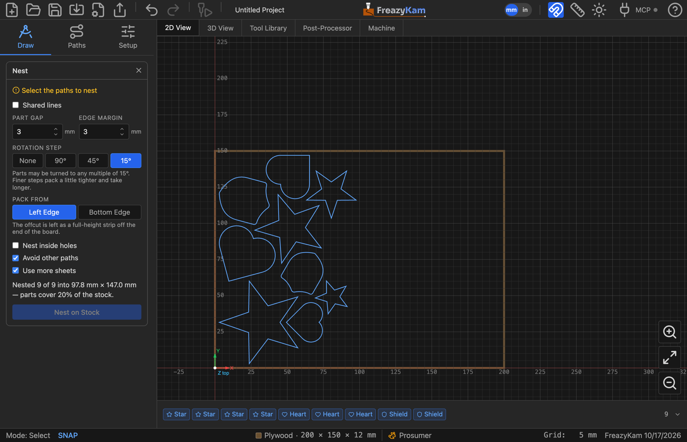

# Nest parts on a sheet

**Nest** packs parts onto the stock to save material.

1. Select the parts.
2. Under **Path Tools**, click **Nest**.
3. Set:

   | Setting | Typical |
   |---|---|
   | Part Gap | Tool diameter plus a little |
   | Edge Margin | Room for clamps |
   | Rotation Step | **15°** for plywood/MDF, **None** if grain matters |
   | Pack From | **Left Edge** or **Bottom Edge** |

4. Click **Nest on Stock**.
5. Regenerate any amber operations, and check your tabs. Packed tight? Use
   [holding strips](hold-a-nested-sheet.md) instead.

Parts that don't fit go onto more sheets of the same stock (**Use more sheets**, on by
default). Untick it and they're parked above the stock instead.

## More options

| Option | Use when |
|---|---|
| **Shared lines** | Place parts one cutter apart so neighbours share a cut. Pick the end mill, then use Profile's **Optimize Path** |
| **Fill stock with copies** | You want many of one part (button becomes **Fill Stock**) — see below |
| **Nest inside holes** | You want small parts inside big ones (offcut ends up in pieces) |
| **Avoid other paths** | The sheet already has parts on it |
| **Use more sheets** | The parts won't all fit on one board — see [Work on several sheets](use-several-sheets.md) |

## Fill the stock with one part

1. Draw the part and give it its toolpaths and tabs first.
2. Select just that part (a part can be several paths, such as a plate and the text inside it).
3. Open **Nest**, tick **Fill stock with copies**.
4. Set **Parts** to how many you want, counting the original, or leave it blank for as
   many as fit.
5. Leave **Copy its toolpaths to every copy** ticked.
6. Click **Fill Stock**.

Every copy gets the part's toolpaths and tabs. The copied toolpaths share a batch with the
original, so editing one edits them all. Inlays are not copied, since they're cut as a pair.

To change the fill later, click its **Nest ×N** chip in the Objects strip, change the
settings in **Edit Nest**, and click **Update Nest**.

**Related:** [Nesting for a usable offcut](../explanation/nesting.md) ·
[User guide: Fill stock with copies](../../docs/09-nesting.md#fill-stock-with-copies)
