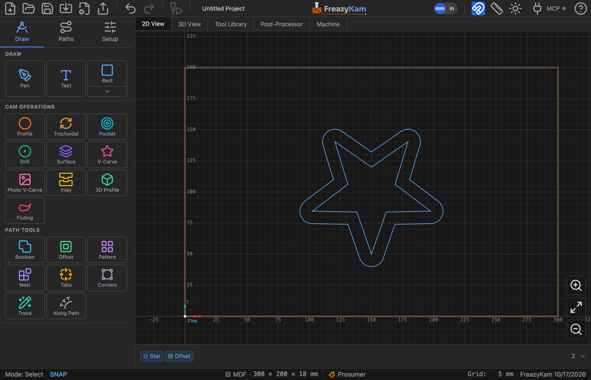

# Grow or shrink a shape (Offset)

Draw a new outline a set distance outside or inside a shape. **Offset** is under
**Path Tools** in the Draw tab.

1. Select one or more shapes.
2. Click **Offset**.
3. Type a **Distance**: positive grows, negative shrinks.
4. Pick a **Corner Style**: **miter**, **round** or **square**.
5. Click **Apply Offset**.

A rectangle, circle, star or other basic shape stays that shape with new settings. Tick
**Keep shape** to offset any other outline by scaling it to an average gap.

Click the result's chip in the Objects strip to change the settings later.

**Related:** [Combine shapes](combine-shapes.md) · [Repeat a shape](repeat-a-shape.md)
