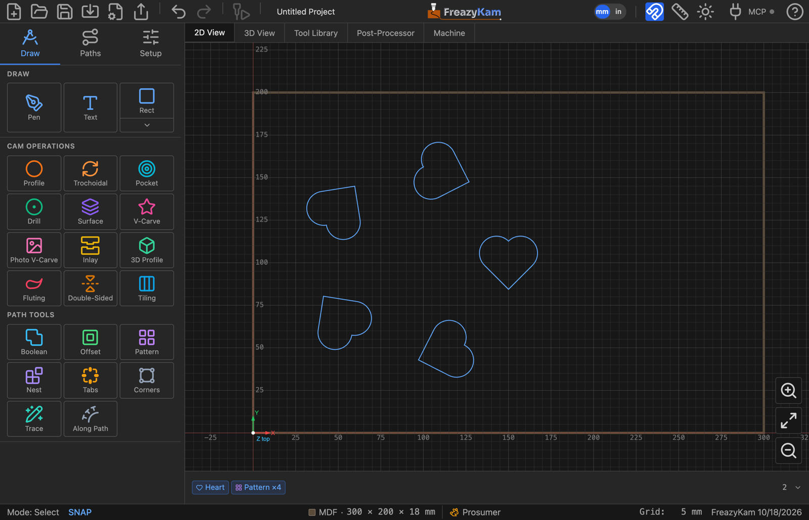

# Repeat a shape (Pattern)

Lay out copies of a shape in a grid or a ring. **Pattern** is under **Path Tools** in the
Draw tab.

1. Select one shape or group.
2. Click **Pattern**.
3. Pick a **Mode**:
   - **linear:** set **Rows**, **Cols**, and the **X Gap** and **Y Gap** between copies.
   - **circular:** set **Count**, **Radius**, **Start°** and **End°**. Tick **Rotate items**
     to turn each copy to face outward.
4. Click **Apply Pattern**.

Click the result's chip in the Objects strip to change the settings later. Changing the count keeps the copies you already have.

**Related:** [Place copies with the mouse](duplicate-shapes.md) · [Nest parts on a sheet](nest-parts.md)
