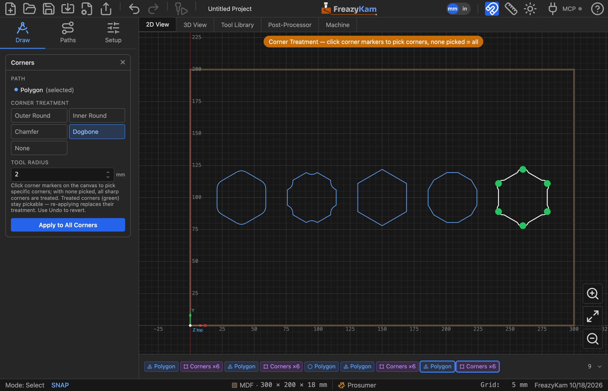

# Round, chamfer or dogbone corners (Corners)

Change the corners of a shape. **Corners** is under **Path Tools** in the Draw tab.

1. Select one shape.
2. Click **Corners**.
3. Under **Corner Treatment**, pick **Outer Round**, **Inner Round**, **Chamfer** or
   **Dogbone**.
4. Set the **Radius**.
5. Click corner markers on the canvas to pick corners, or pick none to treat them all.
6. Click **Apply to All Corners** (or **Apply to N Selected Corners**).

**Dogbone** lets a square part fit a pocket cut by a round bit. Its field is **Tool Radius**:
enter your bit's radius. **None** removes a treatment.

Click the shape's **Corners** chip in the Objects strip to change the treatment later.

**Related:** [Combine shapes](combine-shapes.md) · [Add holding tabs](add-holding-tabs.md)
