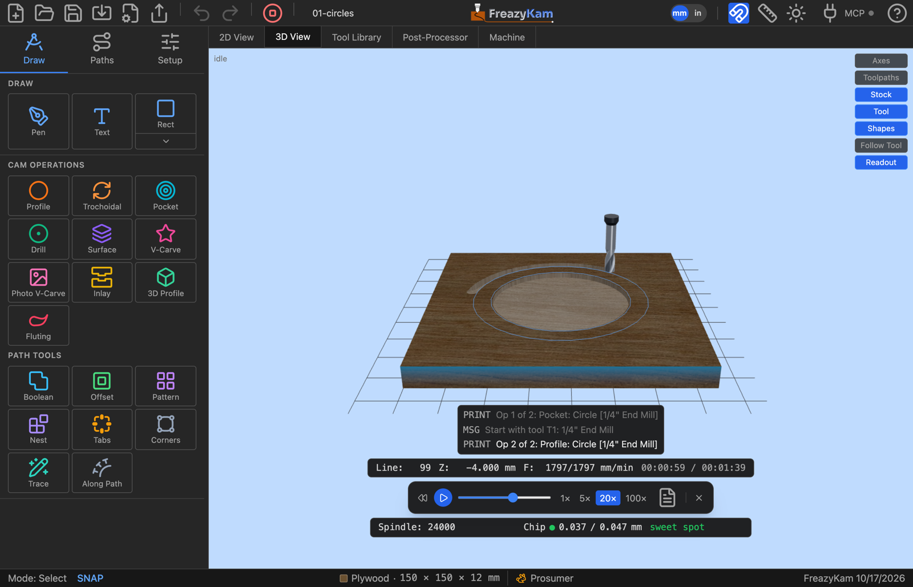
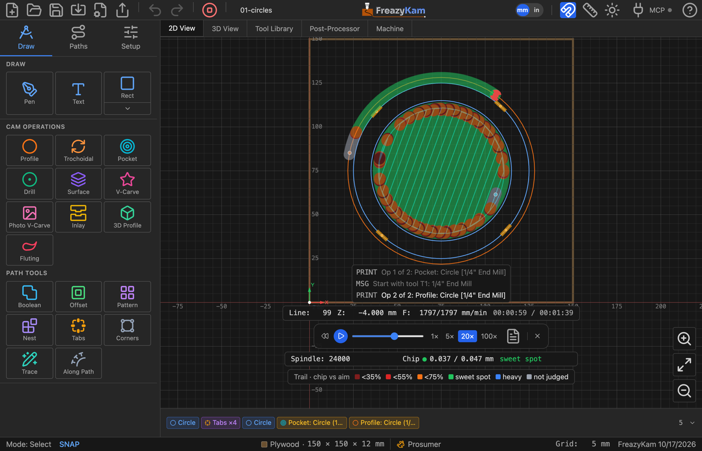

# Simulate a job

1. Click **Simulate G-code** in the toolbar (the green button). It's grey until there is a
   toolpath to simulate.
2. Click **3D View** to see material removed.
3. Press **Play** (or **Space**).

It opens showing the finished part. Play starts from bare stock.

On [several sheets](use-several-sheets.md), it plays the one picked in the toolbar's
**◀ Sheet 1 of 3 ▶** picker.

In the **2D View** it plays flat, with a trail coloured by chip load behind the tool —
the quicker read for travel moves and the order of the cuts.

## Controls

| Control | Does |
|---|---|
| Play / Pause | Start or stop (**Space**) |
| Reset | Back to start |
| Slider | Jump anywhere |
| 1× 5× 20× 100× | Speed |
| Document icon | Show the G-code |
| **×** | Close |

While the simulation is open, the toolbar's Simulate button turns into a red **Stop**.
It closes the simulation too, even when you've hidden the player in the 3D view.

## What to look for

- The total **time**.
- The **chip load** colour: 🟢 is good.
- Pockets too deep, flat spots, missed areas.

Change an operation and the simulation updates by itself.

**Related:** [What a simulation can't tell you](../explanation/simulation-limits.md)
