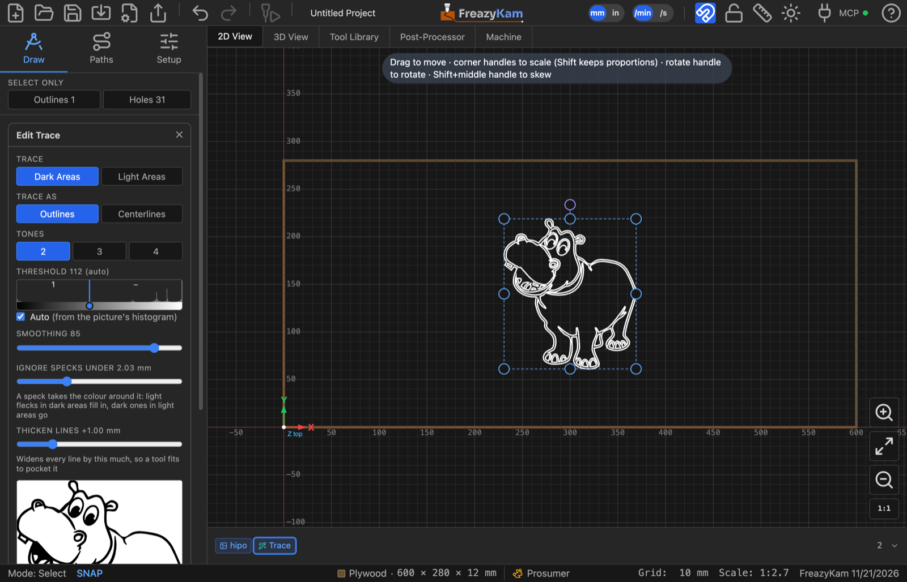

# Trace a picture into paths

Turn a logo, clip art or a cartoon (PNG or JPEG) into paths you can cut.

1. Import the picture with **Import** in the toolbar.
2. Select it, then click **Trace Image** in the Properties panel, or **Trace** under
   **Path Tools** in the Draw tab.
3. Under **Trace**, pick **Dark Areas** (ink on a light background) or **Light Areas**.
4. Under **Trace As**, pick **Outlines** for shapes to pocket, V-carve or inlay, or
   **Centerlines** for one groove down each line.
5. Watch the preview and the canvas, and adjust the settings below until it looks right.
6. Click **Trace**.

## The settings

| Setting | Does |
|---|---|
| **Tones** | **2** traces one shape. **3** or **4** trace that many brightness bands, each as its own layer |
| **Threshold** | How dark a pixel must be to count. Leave **Auto** on unless the result is wrong |
| **Smoothing** | Higher gives smoother curves. Sharp corners stay sharp |
| **Ignore Specks Under** | Drops shapes and holes smaller than this |
| **Thicken Lines** | Widens every line so a bit fits inside it. Set it to at least your bit's diameter to pocket line art. Outlines only |

## Change it later

Change a setting and click **Update Trace**: the old paths are replaced, so generate any
toolpaths on them again. **Show Image** brings the picture back to compare.

A photograph traces as thousands of specks. Use [Photo V-Carve](carve-a-photo.md) for one
instead.

**More detail:** [Tracing a picture](../../docs/02-canvas.md#tracing-a-picture) in the user
guide. **Related:** [Import a drawing or model](import-a-file.md)
