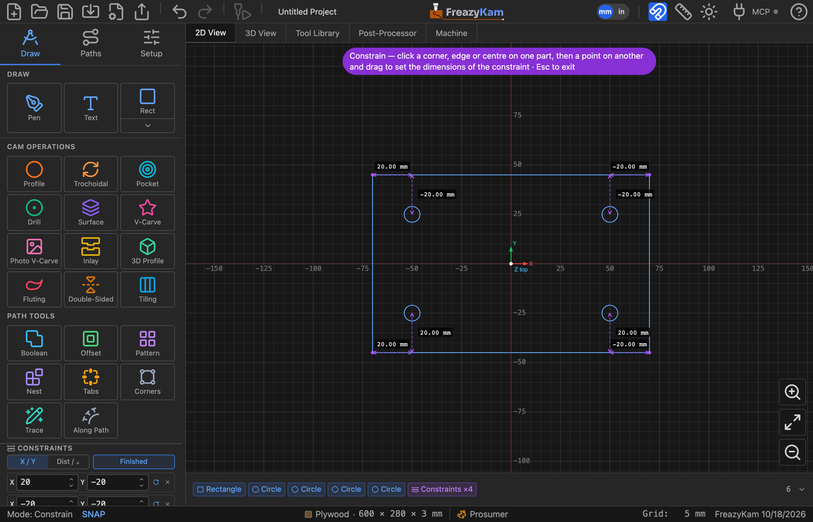

# Keep a part a set distance from another

A **constraint** holds a part in place relative to another, even when you resize or turn
the first. Example: four holes that stay 10 mm in from a plate's corners.

## Add one

1. Press **C**.
2. Hover a part. Snap points appear. The one you'd pick turns amber.
3. Click a point on the first part.
4. Click a point on the second part.
5. Type the distance you want in the **X** and **Y** boxes.
6. Press **Esc** twice when done.

Nothing moves when you create it. It holds the current distance until you type a new one.

## Hold a part off the stock edge

With the Constrain tool (**C**), click a point on the part, then move to an edge of the
stock. The edge lights up when you're close. Click it to hold the part where it is, or
press on the edge and drag to pull the part in or out, with the distance shown as you go.
You can also do it the other way round: click the edge first, then click or drag a point on
the part.

## Keep a bolt circle centred on a part

1. Make the holes with **Pattern** (circular), as usual. No need to group them.
2. Press **C**. Click the centre of the part, then the crosshair at the middle of the
   hole pattern.

The whole pattern now moves with the part. You can still reopen the pattern and change
the count or radius — it stays centred.

## Edit or remove

| To | Do |
|---|---|
| Change the distance | Type in the row |
| Free one direction | Click the **X** or **Y** label |
| Let it turn with the first part | Click **↻** |
| Delete | Click **✕** (nothing moves) |

## Rows turned red?

Two constraints are fighting. Delete one. See [Over-constrained](../reference/messages.md#over-constrained).
