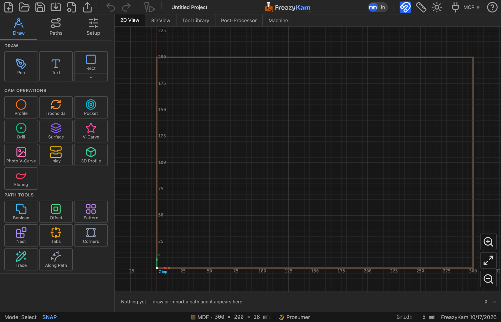

# The screen

| Area | Where | Holds |
|---|---|---|
| **Toolbar** | Top | New, Open, Save, Import, Export G-code, Export SVG, Undo, Redo, Simulate (Stop while a simulation is open), mm/in, Snap, Theme, **MCP** (AI assistant), **?** help mode (click it, then click any button or panel to open its help page) |
| **View tabs** | Under toolbar | 2D View, 3D View, Tool Library, Post-Processor, Machine |
| **Sidebar** | Left | Draw, Paths, Setup tabs |
| **Canvas** | Middle | Your drawing and toolpaths |
| **Objects strip** | Bottom | One chip per thing in the project |
| **Status bar** | Very bottom | Mode, stock size, rigidity, snap, grid |

## Toolbar

| Button | Does |
|---|---|
| New, Open, Save | [Save and reopen a project](../how-to/save-a-project.md) |
| Import | [Import a drawing or model](../how-to/import-a-file.md) |
| Export G-code | [Export G-code](../how-to/export-g-code.md) |
| Export SVG or DXF | The selected paths, or all of them, for another program |
| Undo, Redo | Step back and forward through your edits |
| Simulate | [Simulate a job](../how-to/simulate-a-job.md). Turns into **Stop** while a simulation is open |
| Project name | Click to rename the project |
| mm / in, /min / /s | [Switch between mm and inches](../how-to/switch-units.md) |
| Magnet | [Snap to the grid and to other parts](../how-to/snap-to-grid.md) (S) |
| Lock | [Stop parts moving by accident](../how-to/lock-dragging.md) (L) |
| Ruler | [Measure a distance](../how-to/measure-a-distance.md) (M) |
| Sun / moon | [Light or dark theme](#light-or-dark-theme) |
| MCP | [Connect an AI assistant](../how-to/connect-an-ai-assistant.md) |
| ? | Help mode: click any button or panel to open its help page (?) |

## Light or dark theme

The **sun / moon** button in the toolbar switches the whole app between a dark theme and a
light one. In the dark theme it shows a sun (click for light); in the light theme, a moon
(click for dark).

The app starts dark. Your choice is saved in this browser, so it stays after a reload; it
is not part of a project file. It changes only how the screen looks, never the drawing or
the G-code.

Light can be easier to read in a bright workshop or on a screen in sunlight; dark is kinder
to the eyes in a dim room.

## View tabs

| Tab | Shows |
|---|---|
| **2D View** | The drawing and its toolpaths, where you draw and generate |
| **3D View** | The stock in 3D, carved as a simulation runs |
| **Tool Library** | [Your cutters](tools.md) |
| **Post-Processor** | [How G-code is written for your controller](post-processor.md) |
| **Machine** | [Driving a FluidNC machine](machine-tab.md) |

## Objects strip

The strip under the canvas has one chip per thing in the project: every path, clock and
operation. A group, a multi-part shape, or everything one Generate made is one chip.
Tabs and corner treatments get their own chip, beside the path they belong to.

- **Click** a chip to select what it stands for and reopen the form that made it.
- **Hover** a chip and click its **✕** to delete the thing itself.

## Status bar

| Shows | Means |
|---|---|
| **Mode** | The tool in use |
| **SNAP** | [Snapping](../how-to/snap-to-grid.md) is on |
| **X, Y** | Where the mouse is, measured from the work origin |
| Material and size | The stock. Change it in **Setup** |
| Rigidity | How hard auto feeds and speeds push. Change it in **Setup** |
| **Grid** | The size of one grid square at this zoom |
| **Calibrate screen** / **Scale** | Set up this screen so **1:1** shows parts at real size |

Messages appear here too. Click one to dismiss it.

## Sidebar tabs

| Tab | Contains |
|---|---|
| **Draw** | Draw (Pen, Text, shapes) · CAM Operations · Path Tools |
| **Paths** | **Paths** view (everything by name, plus Properties) · **Toolpaths** view (cut order and times) |
| **Setup** | Stock, origin, material, feeds and speeds, settings file |

## Draw tab groups

| Group | Buttons |
|---|---|
| Draw | Pen · Text · Shape button (arrow opens the picker) |
| CAM Operations | Profile · Trochoidal · Pocket · Drill · Surface · V-Carve · Photo V-Carve · Inlay · 3D Profile · Fluting |
| Path Tools | Boolean · Offset · Pattern · Nest · Tabs · Corners · Trace · Along Path · Duplicate |

## Status ring on chips and rows

| Ring | Means |
|---|---|
| Amber | Needs regenerating |
| Red | Failed |
| Spinner | Working |
